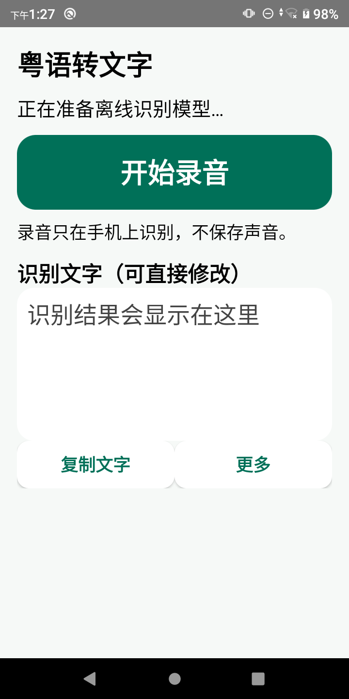
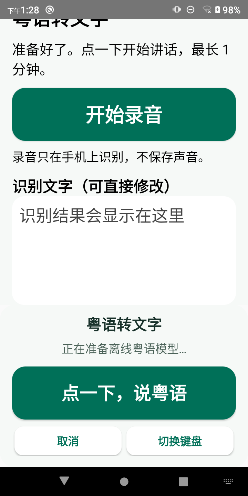

# 粤语转文字

**说粤语，出文字。离线识别，讲完可以改。**

这是一款面向日常聊天的 Android 粤语语音输入工具。打开应用就能录音、查看文字并复制；也可以启用「离线粤语语音输入」，在微信等应用的**文字输入框**里说话，核对文字后自行发送。

[下载 Android APK](https://github.com/frandy820/yueyu-offline-stt/releases/download/android-v0.2.1-preview/yueyu-offline-ime-0.2.1-debug-arm64.apk) · [查看发布页](https://github.com/frandy820/yueyu-offline-stt/releases/tag/android-v0.2.1-preview)

## 看看界面

| 独立使用 | 在文字输入框使用 |
|:--:|:--:|
|  |  |

大按钮一按就说，识别后的文字可以检查和修改。声音只在手机内处理，**不保存原始录音**；应用不申请网络权限。

## 粤语可以这样说

| 说出来的粤语 | 转成文字 | 普通话意思 |
|---|---|---|
| 今日晏啲先返屋企。 | 今日晏啲先返屋企。 | 今天晚一点才回家。 |
| 你记得带遮，出面落雨。 | 你记得带遮，出面落雨。 | 记得带伞，外面下雨。 |
| 我哋听日再倾啦。 | 我哋听日再倾啦。 | 我们明天再聊。 |

以上是**使用示例**，用来说明粤语转写与普通话释义的区别，不是实测逐字输出。应用主要做粤语转文字，表中的普通话释义仅供理解，**不是应用内置翻译功能**。

## 实测数据

使用同一批已人工核对的粤语片段，在电脑端测试随 APK 使用的识别模型及当前分段方式：

| 样本 | 参考文字 | 错误字符 | 字符错误率（CER） |
|---:|---:|---:|---:|
| 24 段 | 1,546 字 | 141 字 | **9.12%** |

字符错误率按插入、删除、替换的字符数计算。数字反映这批样本的电脑端测试结果，**不等于每个人、每部手机的识别准确率**。

## 安装和使用

1. 下载 [APK](https://github.com/frandy820/yueyu-offline-stt/releases/download/android-v0.2.1-preview/yueyu-offline-ime-0.2.1-debug-arm64.apk)。适用 Android 10 及以上、ARM64 架构的手机。
2. 安装后打开「粤语转文字」，首次录音时允许麦克风权限。
3. 在应用里说话、改字和复制。若要在微信里输入文字，先到系统设置启用「离线粤语语音输入」，再在聊天的**文字输入框**切换到这个输入法；文字出现后由你确认是否发送。

微信原有的「按住说话」仍发送语音，不会调用本应用。

当前下载的是 **0.2.1 调试体验版**。APK 大小为 266,861,576 字节；SHA-256：

`DD07B853AEA786CA40936CA58B6AE0F8AB1573FF4037A242E57A524DA9923347`

## 关于发布

本仓库提供 APK 与使用说明，不公开本项目源码。APK 放在 Release 附件中，没有进入 Git 历史，也没有网页体验版的到期控制。第三方组件与模型来源见[第三方说明](THIRD_PARTY_NOTICES.md)。

Android APK 不能安装在 iPhone。iPhone 可先体验[网页版本](https://yueyu-tingxie-2026.chihhsien-6175.chatgpt.site/)；网页版本有单独的试用期，且网页前端代码会交付到浏览器。
